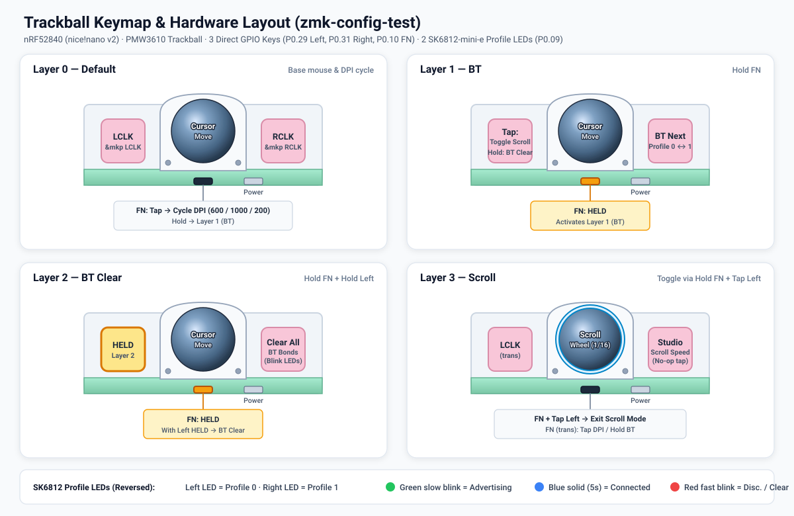

# zmk-config-test

Custom [ZMK](https://zmk.dev/) firmware configuration for a wireless 3-button **PMW3610 trackball** powered by a **nice!nano v2 clone** (`nRF52840`), featuring per-profile **SK6812-mini-e** Bluetooth status LEDs, toggleable ball-to-scroll mode, persistent DPI cycling, and live customization via **ZMK Studio**.

---

## Supported Features

- **PMW3610 Optical Trackball** (`spi0`, `600 CPI` default, `12 ms` minimum BLE report interval for smooth macOS/Windows/iOS tracking).
- **2-Profile Bluetooth + Per-Profile SK6812-mini-e LEDs** (`spi3`, 2 addressable LEDs on `P0.09`, software-reversed so Left LED = Profile 0 and Right LED = Profile 1).
- **Toggleable Trackball Scroll Mode**: Hold **FN** + tap **Left** to toggle axis-snapped 2D ball-to-scroll (`zmk-scroll-snap`, `1/16` scaling, Y-inverted for standard wheel direction) while keeping Left/Right clicks and FN active.
- **Persistent DPI Cycle + Custom DPI via ZMK Studio**:
  - Quick-tap **FN** cycles through `200`, `600`, and `1000` DPI and saves the choice to flash.
  - **ZMK Studio** can also assign any custom DPI from `200` to `3200` (in steps of `200`) directly to the **FN** key.
- **ZMK Studio (USB & BLE)** unlocked by default (`CONFIG_ZMK_STUDIO_LOCKING=n`) with a hardware-accurate physical layout.
- **Deep Sleep Power Management** (`CONFIG_ZMK_SLEEP=y`).

---

## Hardware & Pinout

| Component | Bus / Mode | Pin(s) | Notes |
| --- | --- | --- | --- |
| **Controller** | — | — | `nice_nano@2.0.0//zmk` (nRF52840) |
| **Left Key** | Direct GPIO | `P0.29` | Active-low, internal pull-up, wakeup-source |
| **Right Key** | Direct GPIO | `P0.31` | Active-low, internal pull-up, wakeup-source |
| **FN Key** | Direct GPIO | `P0.10` | Active-low, internal pull-up, wakeup-source |
| **PMW3610 Sensor** | `spi0` | `SCK: P1.11`, `MOSI/MISO: P1.13`, `CS: P1.15`, `IRQ: P0.02` | `invert-x`, `force-awake` |
| **2× SK6812-mini-e LEDs** | `spi3` (`ws2812-spi`) | `DIN (MOSI): P0.09` | `chain-length = 2`, `GRB`, brightness `1` |

---

## Keymap & Layers

| Layer | Name | Activation | Left Key | Right Key | FN Key | Trackball |
| --- | --- | --- | --- | --- | --- | --- |
| `0` | **Default** | Always active | `&mkp LCLK` | `&mkp RCLK` | Tap: Cycle DPI (`200 / 600 / 1000`) Hold: Layer 1 (`BT`) | Cursor move |
| `1` | **BT** | Hold **FN** | Tap: Toggle Layer 3 (`Scroll`) Hold: Layer 2 (`BT Clear`) | `&bt BT_NXT` (Cycle Profile `0 ↔ 1`) | `&trans` (held) | Cursor move |
| `2` | **BT Clear** | Hold **FN** + Hold **Left** | `&trans` (held) | `&bt_clr_all_led` (Clear all BT bonds + blink LEDs) | `&trans` (held) | Cursor move |
| `3` | **Scroll** | Hold **FN** + Tap **Left** | `&trans` (`LCLK`) | `&trans` (`RCLK`) | `&trans` (DPI / `BT`) | Scroll wheel (`1/16`) |

### Quick Usage
- **Cycle DPI**: Quick-tap **FN**.
- **Toggle Scroll Mode**: Hold **FN** → tap **Left** → release **FN**. Repeat to return to cursor movement.
- **Switch Bluetooth Profile (0 ↔ 1)**: Hold **FN** → tap **Right** → release **FN**.
- **Clear All Bluetooth Bonds**: Hold **FN** → hold **Left** (>200 ms) → tap **Right** → release both.

---

## Behaviors & ZMK Studio

### Custom Behaviors
- **`dpi_set` (`zmk,behavior-sensor-attr-set`)** — implemented in [src/behavior_sensor_attr_set.c](src/behavior_sensor_attr_set.c):
  - `param1 = 0`: cycles the fixed `values = < 200 600 1000 >` list.
  - `param1 = 200..3200` (step `200`): clamps/snaps to the nearest multiple of `200` and sets that CPI on `&trackball`.
  - Persists the active DPI and cycle index in flash (`SETTINGS`) and restores them after boot (`load_delay = 1500 ms`).
- **`fn_dpi` (`zmk,behavior-hold-tap`, `hold-preferred`, `200 ms`)**:
  - Hold activates `BT` (Layer 1); tap invokes `dpi_set`.
- **`bt_scroll` (`zmk,behavior-hold-tap`, `hold-preferred`, `200 ms`)**:
  - Hold activates `BT Clear` (Layer 2); tap toggles `Scroll` (Layer 3).
- **`&bt_clr_all_led` (`zmk,behavior-bt-profile-led`)**:
  - Clears all Bluetooth bonds and triggers the all-LED quick-blink confirmation.

### Using ZMK Studio
1. Open [zmk.studio](https://zmk.studio/) and connect over **USB** or **Bluetooth**.
2. Click the **FN** key on Layer 0 (`FN / DPI`), keep Param 1 set to **BT**, and select either **Cycle DPI** (`0`) or any explicit value from **200 DPI** to **3200 DPI** for Param 2.
3. Click **Save**.

> **Note:** Changes saved in ZMK Studio are stored in NVS flash and override future `.keymap` edits until you click **Restore Stock Settings** in ZMK Studio (or flash a `settings_reset` firmware).

---

## Bluetooth Profile LED Indicators

Configured via `zmk-bt-profile-led` with `CONFIG_BT_PROFILE_LED_STRIP_REVERSE=y`:
- **Left LED (pixel 1)** → Bluetooth Profile `0`
- **Right LED (pixel 0)** → Bluetooth Profile `1`

| State | Color & Pattern |
| --- | --- |
| **Advertising / Empty profile** | Green slow blink (`500 ms`) |
| **Connected** | Blue solid ON (`5000 ms`), then OFF to save power |
| **Disconnected (bonded)** | Red fast blink (`150 ms`) |
| **Clear all profiles** | Red fast blink across both LEDs (`5×` at `150 ms`) |

---

## Building & Flashing

1. Push changes to GitHub; the [Build ZMK firmware](.github/workflows/build.yml) GitHub Actions workflow builds `nice_nano@2.0.0//zmk` + `test` with ZMK Studio enabled.
2. Download the `firmware` artifact (`.uf2`) from the completed workflow run.
3. Connect the trackball via USB, double-tap the **Reset** button to mount the `NICENANO` UF2 drive, and copy the `.uf2` file onto it.

---

## Contributing

Contributions, bug reports, and improvements are welcome:
1. Fork this repository and create a feature branch.
2. Keep `POST_KERNEL` initialization ordering intact in [test.conf](config/boards/shields/test/test.conf) (`SPI=37` → `PMW3610=38` → `INPUT=39` → `hold-tap=40`) so Zephyr's `check_init_priorities` validation passes.
3. Update [images/keymap.svg](images/keymap.svg) if keymap bindings or layers change.
4. Open a pull request describing your hardware/keymap changes and test results.

---

## Credits & Modules Used

- **[zmkfirmware/zmk](https://github.com/zmkfirmware/zmk)** — Core ZMK wireless keyboard firmware.
- **[badjeff/zmk-pmw3610-driver](https://github.com/badjeff/zmk-pmw3610-driver)** — `pixart,pmw3610-alt` optical trackball sensor driver.
- **[kot149/zmk-scroll-snap](https://github.com/kot149/zmk-scroll-snap)** — Axis-locking scroll snap input processor (`&zip_scroll_snap`).
- **[vinhcatba/zmk-bt-profile-led](https://github.com/vinhcatba/zmk-bt-profile-led)** — Per-profile Bluetooth connection status LED widget & `&bt_clr_all_led` behavior (based on **[caksoylar/zmk-rgbled-widget](https://github.com/caksoylar/zmk-rgbled-widget)** and **[awkannan/zmk-smart-rgbled-widget](https://github.com/awkannan/zmk-smart-rgbled-widget)**).
- **[george-norton/zmk-behavior-sensor-attr-cycle](https://github.com/george-norton/zmk-behavior-sensor-attr-cycle)** — Inspiration and reference for sensor attribute cycling and settings persistence used in `behavior_sensor_attr_set.c`.
